# TDD_Test_Report_004-3_Session1_(Shogun)

| **Feature** | **Expected output** | **Test Case Number** | **Test Case Name** | **Dev** | **Test Date** |
| --- | --- | --- | --- | --- | --- |
| 004-3 | Heat equal to limit: heat_exceeded=False | 1 | Heat equals limit | Shogun | Not recorded |
| 004-3 | Heat above limit: heat_exceeded=True | 2 | Heat above limit | Shogun | Not recorded |
| 004-3 | Freeze equal to limit: freeze_exceeded=False | 3 | Freeze equals limit | Shogun | Not recorded |
| 004-3 | Freeze above limit: freeze_exceeded=True | 4 | Freeze above limit | Shogun | Not recorded |
| 004-3 | Heat exceeded True; freeze at limit False | 5 | Heat and freeze compared independently | Shogun | Not recorded |

Testcase 1 Try heat_s = heat_limit_s expected : heat exceeded => False

Red - Not yet implement comparison.py

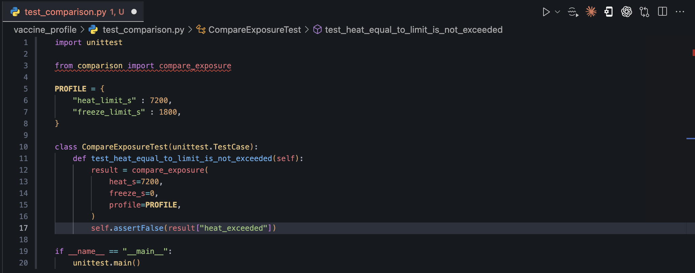

result: 

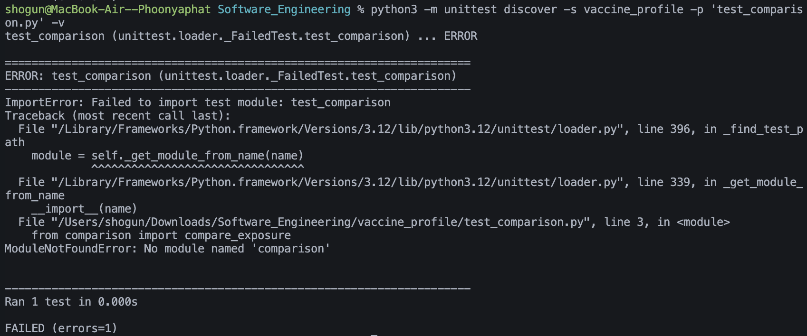

Green - Implement comparison.py

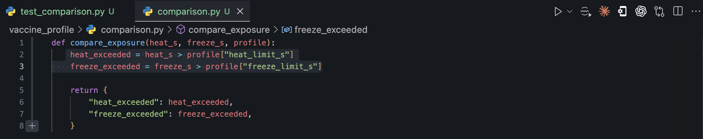

result: 

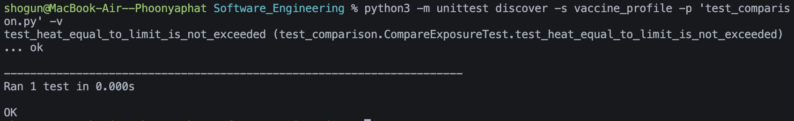

Refactor - Not yet need to refactor

Testcase 2 Try heat_s > heat_limit_s expected : heat exceeded => True

Green

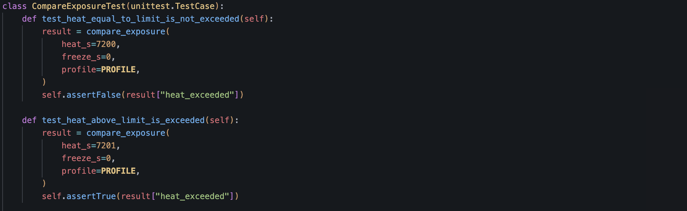

result: 

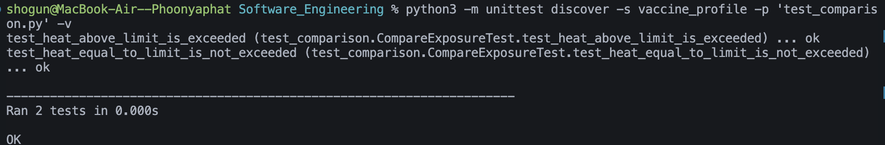

Testcase 3 Try freeze_s = freeze_limit_s expected : freeze exceeded => False

Green

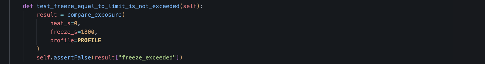

result: 

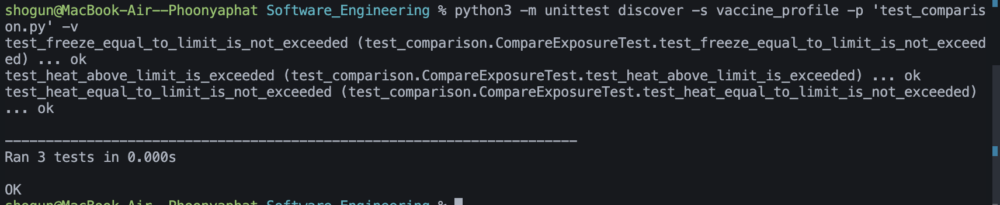

Testcase 4 Try freeze_s > freeze_limit_s expected : freeze exceeded => True

Green

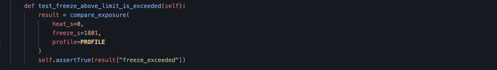

result: 

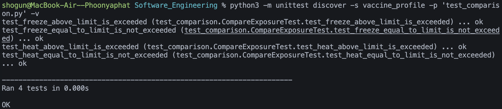

Testcase 5 Check if heat_limit_s and freeze_limit_s work separately

Green

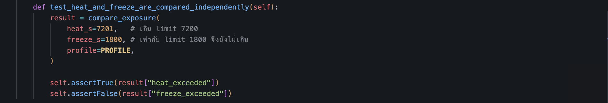

result

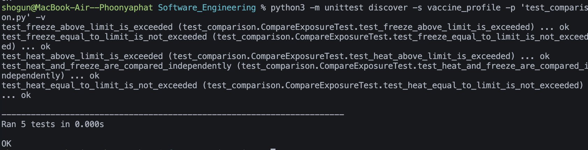
